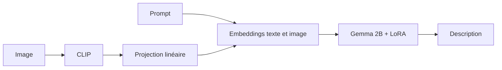

# Modèle et API

Le notebook utilise `openai/clip-vit-base-patch32` et `unsloth/gemma-2b-bnb-4bit`. La projection transforme le vecteur CLIP vers la dimension cachée de Gemma. Le token `<|image|>` place ce vecteur dans la séquence de texte.

Les exemples associent une image ROCOv2 à sa légende. La loss ignore le prompt et le padding. Les augmentations d’image restent dans l’entraînement ; la validation utilise les images non augmentées.

L’API charge le même tokenizer, les adaptateurs LoRA et la projection exportée. Elle génère le texte de façon autorégressive, puis retire les balises et les phrases répétées. Le nettoyage conserve les phrases courtes et les négations.

Sans les poids de la projection entraînée, l’API refuse de démarrer. Un dossier contenant uniquement les adaptateurs LoRA ne suffit pas.

Cette version retire les sorties des notebooks, les cellules de connexion personnelle et les téléchargements depuis Drive. Elle ajoute l’export complet et corrige l’accès à l’image dans les cellules conservées.
